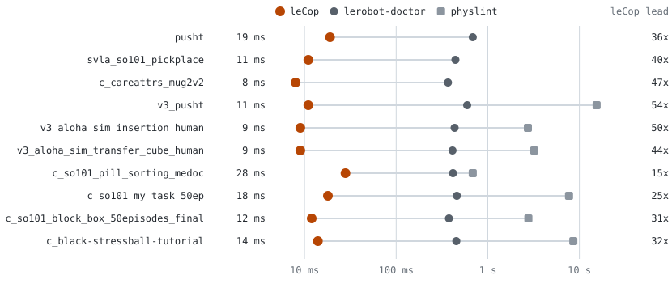

# How leCop compares with other tools

What [lerobot-doctor](https://pypi.org/project/lerobot-doctor/) 0.2.0 and
[physlint](https://pypi.org/project/physlint/) 0.4.0 check, read from their installed rule lists and source,
against what leCop checks. physlint also validates MCAP and ROS 2 recordings, which is out of scope here.
✅ checked, ⚠️ partly checked or needs thresholds you set, ❌ not checked.

| Check | leCop | lerobot-doctor | physlint |
|---|---|---|---|
| `info.json` readable, version supported, `fps` positive | ✅ | ✅ | ✅ |
| `info.json` required fields present | ✅ | ✅ | ✅ |
| `total_episodes`, `total_frames` match the metadata | ✅ | ✅ | ✅ |
| `total_tasks` matches the task metadata | ✅ | ✅ | ❌ |
| Data and episode-metadata files exist and are readable | ✅ | ✅ | ✅ |
| Episode ids unique, contiguous, boundaries and global `index` valid | ✅ | ⚠️ | ✅ |
| Timestamps monotonic, match `fps`, no dropped-frame gaps | ✅ | ✅ | ✅ gap limit by config |
| `frame_index` sequential within each episode | ✅ | ✅ | ❌ |
| Declared dtype and shape match the stored data | ✅ float list widths | ⚠️ | ✅ |
| Same features in every episode (missing, extra, dtype, shape) | ✅ | ✅ | ⚠️ |
| Required streams present (`observation.state`, ...) | ⚠️ `action`, `observation.state`, `timestamp` | ❌ | ⚠️ needs config |
| Streams cover whole episodes; observation/action delay | ❌ | ❌ | ✅ delay by config |
| NaN and Inf in feature columns | ✅ | ✅ | ✅ |
| Numeric limits per feature | ✅ by config | ❌ | ⚠️ needs config |
| Implausible jumps between frames | ✅ also `max_step` by config | ✅ | ⚠️ needs config |
| Constant or frozen action, idle episodes | ✅ | ✅ | ❌ |
| Stuck or constant dimensions, zero variance | ✅ | ✅ | ❌ |
| Values clipped at their min or max | ✅ 5% of frames or more, configurable | ✅ | ❌ |
| Extreme outliers, distribution shift across episodes | ✅ | ✅ | ❌ |
| Duplicate episodes | ✅ exact action sequences | ✅ near-duplicates | ✅ exact |
| Episode length: empty, too short, outliers | ✅ | ✅ | ❌ |
| Statistics file present and covering every feature | ✅ | ✅ | ❌ |
| Statistics match the data (count, min, max, mean, std) | ✅ `stats.json`, v3.x and v2.0 | ❌ compares feature names only | ❌ |
| Video file exists, readable mp4, frame rate | ✅ | ✅ | ✅ |
| Video frame count against the episode (container tables) | ✅ | ✅ | ❌ |
| Video resolution against `info.json` | ✅ | ✅ | ❌ |
| Frames decode, frozen frames, black frames | ✅ opt-in `--decode` (H.264 and AV1) | ⚠️ first frame only | ✅ |
| Portability: absolute paths, symlinks, stray files in `data/`, oversized files | ✅ | ✅ | ❌ |
| Training readiness: zero-std statistics, episodes shorter than the policy chunk | ✅ | ✅ | ❌ |
| Only leCop: v3 video span checks, `range_*`, `index_mismatch` | ✅ | ❌ | ❌ |

Gaps are tracked as issues by priority; see the open issues labelled `feature`.

## Performance

Video is where the tools differ most: lerobot-doctor decodes the first frame of each video, physlint decodes every
frame, and leCop reads container metadata only unless asked. So two tables are reported, each giving the tools compared
the same video work: none decodes in the first, leCop and physlint decode everything in the second. Median wall time of 3 runs after one warm-up, warm page cache, including process start, every run in
a fresh empty working directory with physlint's result cache off. Apple M2 Pro, Python 3.12, leCop `release` build,
lerobot-doctor 0.2.0 and physlint 0.4.0 installed from PyPI. physlint reads v3 only. The tools check different things
(see the comparison above), so this compares speed only. Reproduce with `scripts/compare.py`;
`scripts/speed_chart.py` draws the charts from the tables below. The time axis is logarithmic.

### Without video decoding

lerobot-doctor runs every check but `videos`; physlint runs with its `video.decode`, `video.frozen_frames` and
`video.black_frames` rules off; leCop is the default build.

| Dataset | leCop | lerobot-doctor | physlint | leCop vs the fastest other tool |
|---|---|---|---|---|
| `pusht` (v2.1) | 🏆 **19 ms** | 686 ms | n/a | 36x |
| `svla_so101_pickplace` (v2.1) | 🏆 **11 ms** | 444 ms | n/a | 40x |
| `c_careattrs_mug2v2` (v2.1) | 🏆 **8 ms** | 368 ms | n/a | 47x |
| `v3_pusht` (v3.0) | 🏆 **11 ms** | 596 ms | 15,408 ms | 54x |
| `v3_aloha_sim_insertion_human` (v3.0) | 🏆 **9 ms** | 435 ms | 2,742 ms | 50x |
| `v3_aloha_sim_transfer_cube_human` (v3.0) | 🏆 **9 ms** | 412 ms | 3,213 ms | 44x |
| `c_so101_pill_sorting_medoc` (v3.0) | 🏆 **28 ms** | 417 ms | 685 ms | 15x |
| `c_so101_my_task_50ep` (v3.0) | 🏆 **18 ms** | 460 ms | 7,700 ms | 25x |
| `c_so101_block_box_50episodes_final` (v3.0) | 🏆 **12 ms** | 377 ms | 2,774 ms | 31x |
| `c_black-stressball-tutorial` (v3.0) | 🏆 **14 ms** | 454 ms | 8,582 ms | 32x |

### With video decoding

leCop is built with `--features decode` and run with `--decode`; physlint runs all its rules. Both decode every frame.
Only physlint is compared here, and only on the v3 datasets it reads: lerobot-doctor decodes one frame per video, which
is not the same work.

| Dataset | leCop | physlint | leCop speedup |
|---|---|---|---|
| `v3_pusht` (v3.0) | 🏆 **185 ms** | 21,095 ms | 114x faster |
| `v3_aloha_sim_insertion_human` (v3.0) | 🏆 **2,585 ms** | 11,517 ms | 4.5x faster |
| `v3_aloha_sim_transfer_cube_human` (v3.0) | 🏆 **2,049 ms** | 10,226 ms | 5x faster |
| `c_so101_pill_sorting_medoc` (v3.0) | 🏆 **1,503 ms** | 5,190 ms | 3.5x faster |
| `c_so101_my_task_50ep` (v3.0) | 🏆 **2,664 ms** | 19,661 ms | 7.4x faster |
| `c_so101_block_box_50episodes_final` (v3.0) | 🏆 **1,291 ms** | 5,877 ms | 4.6x faster |
| `c_black-stressball-tutorial` (v3.0) | 🏆 **3,164 ms** | 17,162 ms | 5.4x faster |

leCop splits each video at its keyframes and decodes the pieces in parallel, so one large file uses every core. AV1 is
decoded with rav1d's hand-written assembly, about 3 times faster than the same decoder without it (18 s against 67 s on
`c_so100_press_red_button`, Apple M-series). Every install has it on ARM and on x86_64 Linux, Windows and macOS,
including `cargo install lecop`, with no ffmpeg and no assembler on the machine (see
[Decoding frames](usage.md#decoding-frames)).

### A large dataset: RoboTwin

[`lerobot/robotwin_unified`](https://huggingface.co/datasets/lerobot/robotwin_unified) at commit `1287871`: v3.0, 27,500
episodes, 6,075,103 frames at 30 fps, three AV1 cameras at 640x480, 75 GB on disk (289 MB of parquet, the rest video).
AMD Ryzen 9 7900X (12 cores, 24 threads), 124 GB RAM, Linux, warm page cache. leCop 0.1.2 built with
`cargo build --release --features asm`, the AV1 assembly every x86_64 Linux build has since 0.2.0, Rust 1.99.0, default
thread count.
lerobot-doctor 0.2.0 and physlint 0.4.0 from PyPI on Python 3.14.3. Same commands and configuration as `scripts/compare.py`.
leCop is the median of 3 runs without decoding and of 2 runs with decoding, each after one warm-up. lerobot-doctor
and physlint are single runs, because one physlint run takes almost five hours; an earlier run of each, with a desktop
file indexer busy in the background, took 8% and 10% longer. Wall time and peak memory are from `/usr/bin/time -v`.
The runs were sequential, on an otherwise idle machine.

| Run | leCop | lerobot-doctor | physlint |
|---|---|---|---|
| Without video decoding | 🏆 **0.72 s**, 1.9 GB | 50 min, 5.5 GB | 4 h 42 min, 1.1 GB |
| Decoding every frame | 🏆 **11 min 47 s**, 15 GB | n/a | n/a: cannot decode AV1, see below |

Without decoding, leCop is about 4,200 times faster than lerobot-doctor and 23,000 times faster than physlint on this
dataset. Both Python tools run on one core (100% and 110% CPU), leCop on four on average (413%) without decoding and
on all 24 (2384%) when decoding.

Both Python tools slow down faster than the dataset grows, so the speedup depends on its size: 15x to 54x on the small
datasets above, thousands of times here. lerobot-doctor's near-duplicate check compares every pair of episodes, 378
million comparisons here, about 48 of its 50 minutes at the 7.6 µs one `np.allclose` takes on this machine; leCop
looks for exact duplicates only, by hashing each episode's actions. physlint reads an episode's rows by scanning its whole data file,
once per episode, so each of the 8 files (about 760,000 rows and 3,400 episodes) is read thousands of times.

physlint decodes with the OpenCV wheel from PyPI, whose FFmpeg has no software AV1 decoder. It opens each file, reads
0 frames, and reports `video.decode` errors such as "Decoded 0 of 139 expected frames" on a healthy dataset, after
5 h 39 min. That is not the same work as decoding, so there is no physlint figure in the decoding row.

Where their checks overlap, leCop and lerobot-doctor report the same findings: action jumps in episodes 102, 443 and
19840, and 533 unusually long episodes. leCop reports 0 errors and 1,279 warnings in total; physlint without decoding
passes, with three rules not run because they need thresholds.
